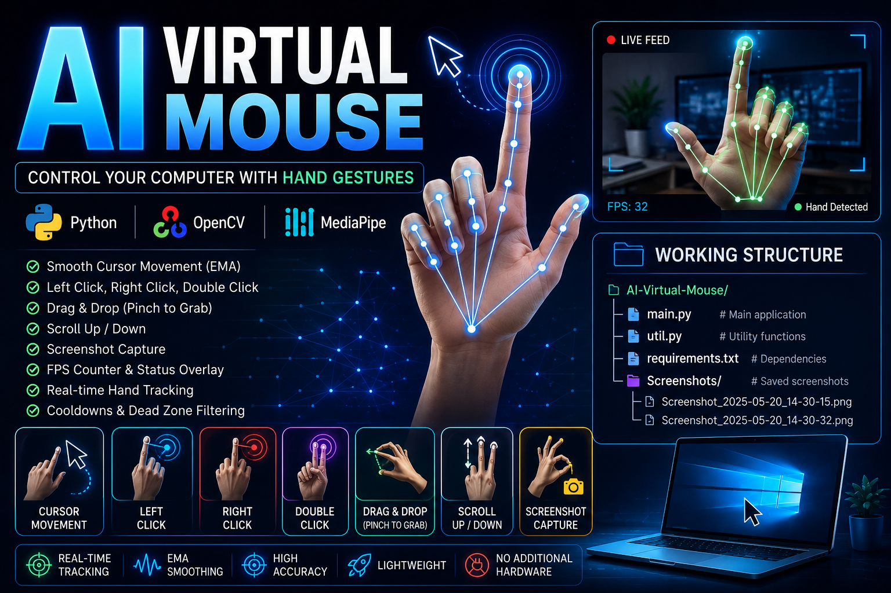
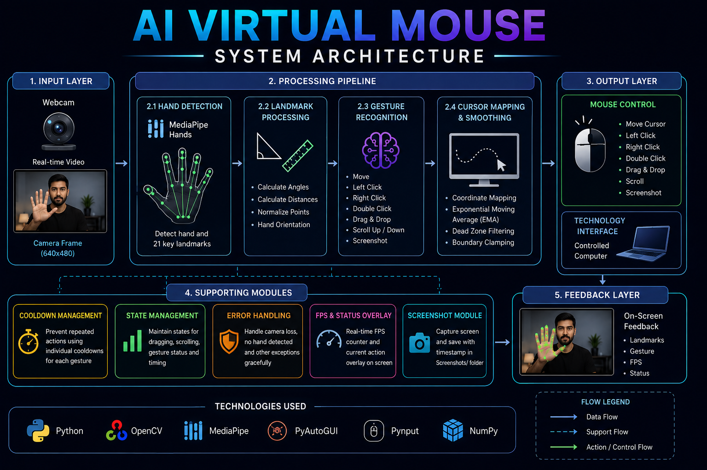
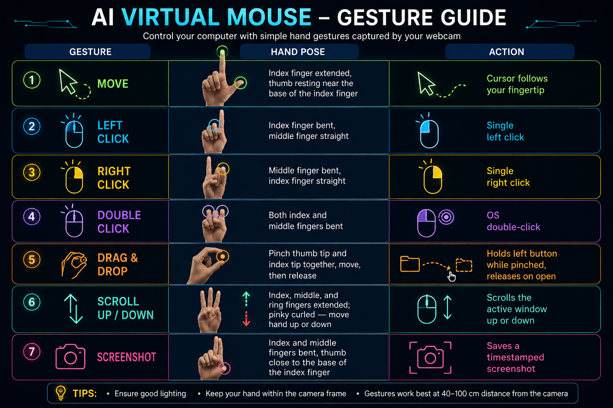

<p align="center">
  
</p>

# AI Virtual Mouse

Control your computer's cursor with nothing but your hand and a webcam. AI Virtual Mouse uses [MediaPipe Hands](https://developers.google.com/mediapipe) and OpenCV to track your hand in real time and translate a small vocabulary of gestures into full mouse functionality — movement, left/right click, double click, drag-and-drop, scrolling, and screenshots.

<p align="center">
  
  
  
  
  
</p>

---

## Table of Contents

- [Features](#features)
- [How It Works](#how-it-works)
- [Gesture Guide](#gesture-guide)
- [Demo Overlay](#demo-overlay)
- [Requirements](#requirements)
- [Installation](#installation)
- [Usage](#usage)
- [Configuration](#configuration)
- [Project Structure](#project-structure)
- [Troubleshooting](#troubleshooting)
- [Roadmap](#roadmap)
- [Contributing](#contributing)
- [License](#license)
- [Acknowledgments](#acknowledgments)

---

## Features

- 🖱️ **Full mouse functionality** — move, left click, right click, double click, drag & drop, scroll up/down, and screenshot capture
- 🎯 **Smooth, jitter-free cursor** — Exponential Moving Average (EMA) smoothing plus a configurable dead zone
- 🖥️ **Full-screen coordinate mapping** — reach every corner of your monitor without stretching your hand to the edge of the camera frame
- ⏱️ **Gesture cooldowns** — debounced clicks and screenshots so one gesture never fires multiple times
- 📸 **Timestamped screenshots** — auto-saved to a `Screenshots/` folder that's created for you
- 📊 **Live on-screen overlay** — FPS, current gesture, cursor status, tracking status, and screen resolution
- 🛡️ **Crash-resistant** — gracefully handles a missing camera, dropped frames, and a hand leaving the frame
- 🪶 **Minimal footprint** — just two Python files and a requirements list, no heavyweight framework or model training required

## How It Works

```
Webcam → MediaPipe Hand Detection → 21-Point Landmarks → Gesture Classification → Action Dispatch → OS Mouse Control
```

<p align="center">
  
</p>
<p align="center"><em>Figure — End-to-end working structure of the AI Virtual Mouse pipeline.</em></p>

1. **Capture** — OpenCV reads frames from your webcam and mirrors them for a natural, "look in a mirror" experience.
2. **Detect** — MediaPipe Hands locates a hand in the frame and returns 21 normalized landmark coordinates.
3. **Classify** — Simple, explainable geometry (joint angles and inter-landmark distances) determines which gesture, if any, is being made.
4. **Act** — The matched gesture triggers a cursor move, click, drag, scroll, or screenshot via PyAutoGUI/pynput.
5. **Display** — A diagnostic overlay is drawn on the video feed so you can see exactly what the system is detecting.

## Gesture Guide

<p align="center">
  
</p>
<p align="center"><em>Figure — Hand poses for each supported gesture.</em></p>

| Gesture | Hand Pose | Action |
|---|---|---|
| **Move** | Index finger extended, thumb resting near the base of the index finger | Cursor follows your fingertip |
| **Left Click** | Keep the index finger pointing and touch your thumb tip to your middle fingertip | Single left click (the cursor stays put while you pinch) |
| **Right Click** | Keep the index finger pointing and touch your thumb tip to your ring fingertip | Single right click |
| **Double Click** | Make the left-click pinch twice in a row, quickly (thumb to middle fingertip, open, again) | Two clicks within the system double-click time (about half a second) become a double click |
| **Drag & Drop** | Pinch thumb tip and index tip together, move, then release | Holds left button while pinched, releases on open |
| **Scroll Up / Down** | Index, middle, and ring fingers extended; pinky curled — move hand up or down | Scrolls the active window |
| **Screenshot** | Keep the index finger pointing and touch your thumb tip to your pinky fingertip | Saves a timestamped screenshot |

> 👆 **Button pinches** (middle = left click, ring = right click, pinky = screenshot): a pinch counts when the fingertips *close in*: either they were first seen clearly apart (past `CLICK_PINCH_RELEASE`), or the distance dropped by at least `CLICK_PINCH_DROP` within the last `CLICK_PINCH_LOOKBACK` seconds and ended in real contact (below `CLICK_PINCH_NEAR`). So a hand whose resting pose keeps the middle fingertip fairly close to the thumb still clicks, while a hand that merely rests there (no closing movement) never does. If two neighbouring fingers are close to the thumb at once, only the closest one acts. Pinches are ignored while you drag (thumb–index pinch). Press **`d`** in the video window to show the live thumb-to-fingertip distances while you tune `CLICK_PINCH_THRESHOLD` / `CLICK_PINCH_RELEASE`.

> 💡 Tip: Keep gestures deliberate and hold them briefly — this gives MediaPipe a stable frame to classify and avoids accidental misfires.

## Demo Overlay

While running, the app overlays live diagnostics directly on the video feed:

```
FPS: 28.4
Gesture: Moving
Cursor: Active
Tracking: Locked
Screen Res: 1920x1080
```

## Requirements

- Python 3.9 or later
- A working webcam
- Windows, macOS, or Linux with a desktop environment (needed for cursor/screenshot control)

Python dependencies (see [`requirements.txt`](requirements.txt)):

| Package | Purpose |
|---|---|
| `opencv-python` | Video capture, frame processing, overlay rendering |
| `mediapipe` | Real-time hand landmark detection |
| `pyautogui` | Cursor movement, double-click, screenshots |
| `pynput` | Cross-platform mouse press/release and scroll events |
| `numpy` | Angle computation and coordinate interpolation |

## Installation

```bash
# 1. Clone the repository
git clone https://github.com/muhammaddaniyal0020/AI-Virtual-Mouse
cd AI-Virtual-Mouse

# 2. (Recommended) Create a virtual environment
python -m venv venv
source venv/bin/activate      # Windows: venv\Scripts\activate

# 3. Install dependencies
pip install -r requirements.txt
```

## Usage

```bash
python main.py
```

- A window titled **"AI Virtual Mouse"** will open showing your webcam feed with hand landmarks and the status overlay.
- Perform any gesture from the [Gesture Guide](#gesture-guide) to control your cursor.
- The faint rectangle in the video is the area your **fingertip** sweeps to cover the whole screen. Keep your fingertip inside it and your wrist inside the frame; a partly visible hand is tracked poorly.
- Keys in the video window: **`q`** quit · **`c`** calibrate your comfortable area · **`r`** reset that area · **`a`** acceleration on/off · **`d`** pinch-distance readout.

**Move less: calibrate your comfortable area.** By default the fingertip sweeps a fixed region of the camera image to cover the whole screen, which may mean lifting your hand higher than you like. Press **`c`**, put your index fingertip at the top-left corner of the area you can reach comfortably and press `c` again, then do the same for the bottom-right corner. That area now covers the whole screen (the smaller it is, the less you move but the less precise you are), and it is remembered in `calibration.json` for this camera resolution. Press `r` to go back to the default. While calibrating, the mouse is not controlled.

**Pointer acceleration** (on by default, `a` toggles it): slow movements stay 1:1 with your fingertip for precision, fast ones travel up to ~1.5× further on screen, and the cursor settles back onto your fingertip when you stop.

Because your hand is driving the cursor, there are also **global hotkeys** that work no matter which window has focus:

| Hotkey | Action |
|---|---|
| `Ctrl` + `Alt` + `P` | Pause / resume cursor control (the video keeps running) |
| `Ctrl` + `Alt` + `Q` | Quit |

**Clicks are locked until you show the Move pose.** Whenever your hand enters the frame (or control is resumed), the click and screenshot pinches are ignored until the system has seen the Move gesture once — so a hand entering the frame with curled fingers can't click by accident. The overlay's `Click:` line says whether a left-click pinch would register right now (`ready`) or why not: `locked (show the Move pose first)`, `blocked (grabbing with thumb+index)`, `blocked (index finger curled)` or `blocked (move thumb and middle finger apart first)`.

Screenshots are saved automatically to a `Screenshots/` folder created in the project directory, named like `Screenshot_2025-07-17_14-32-05.png`.

## Configuration

All tunable behavior lives as named constants at the top of `main.py` — no need to touch the gesture logic to adjust feel or performance.

| Constant | Default | Description |
|---|---|---|
| `SMOOTHING` | `0.7` | EMA smoothing factor for the cursor (higher = smoother but laggier) |
| `FRAME_MARGIN_LEFT` / `_RIGHT` / `_TOP` / `_BOTTOM` | `100` / `100` / `40` / `200` px | Inset of the camera region that the fingertip maps to the full screen. The bottom margin is large so reaching the bottom of the screen doesn't push your wrist out of the frame |
| `CLICK_COOLDOWN` | `0.12` s | Minimum interval between clicks. Kept short so two quick pinches make a double click (the pinch must reopen between clicks anyway) |
| `ACCEL_ENABLED` / `ACCEL_MAX_GAIN` | `True` / `1.6` | Pointer acceleration and its gain at full speed (1.0 = no acceleration) |
| `ACCEL_SPEED_START` / `ACCEL_SPEED_FULL` | `20` / `80` | Fingertip speed (screen px per frame) where acceleration starts and where it reaches the full gain |
| `ACCEL_RECENTER` | `0.25` | How fast the cursor is pulled back onto the fingertip when moving slowly (higher = settles sooner) |
| `CALIBRATION_MIN_WIDTH` / `_HEIGHT` | `160` / `100` px | Smallest comfortable area the `c` calibration accepts |
| `CLICK_PINCH_THRESHOLD` | `40` | Thumb-to-middle/ring/pinky-fingertip distance below which a button pinch closes (normalized by hand size) |
| `CLICK_PINCH_RELEASE` | `70` | Distance above which the pinch counts as open again (hysteresis; must be larger than the threshold) |
| `CLICK_PINCH_DROP` / `CLICK_PINCH_LOOKBACK` | `15` / `0.8` s | A pinch also counts if the distance fell by at least this much within this many seconds, even if the fingertips never went apart past `CLICK_PINCH_RELEASE` |
| `CLICK_PINCH_NEAR` | `28` | The "closing movement" path needs the fingertips to end below this distance (a real contact), so slow finger tremor never clicks |
| `CLICK_PINCH_HOLD` | `55` | Once a pinch has started closing, it keeps counting while the distance stays below this, so jitter around `CLICK_PINCH_THRESHOLD` doesn't restart the count |
| `CLICK_PINCH_TIE` | `10` | If two fingertips are this close in distance to the thumb, the earlier one wins (middle before ring before pinky): a thumb landing between middle and ring is a left click |
| `CLICK_INDEX_MIN_ANGLE` | `70°` | How far the pointing index may curl while you make a button pinch |
| `GRAB_TIE` | `12` | A thumb-index pinch counts as a grab unless another fingertip is closer to the thumb by more than this, so a click pinch with the index near the thumb isn't taken for a grab |
| `CLICK_PINCH_FRAMES` | `2` | Consecutive frames the pinch must stay closed to click |
| `CLICK_FREEZE_SECONDS` | `0.3` s | After a pinch click the cursor stays put for this long (or until the pinch opens), so the click lands where you aimed |
| `MOVE_STAY_ANGLE` / `MOVE_STAY_THUMB_DIST` | `70°` / `90` | Looser limits that keep the Move pose alive once it is active, so a thumb that drifts or an index that dips a little doesn't stop the cursor |
| `STALL_LOG_SECONDS` | `0.15` s | Frames slower than this are logged with a breakdown (camera wait / hand tracking / gestures + drawing) |
| `DRAG_RELEASE_THRESHOLD` / `DRAG_RELEASE_FRAMES` | `70` / `2` | Once dragging, the thumb-index pinch must open past this distance for this many frames to let go, so one noisy frame doesn't drop the window |
| `HAND_LOST_GRACE_DRAG` | `0.8` s | Like `HAND_LOST_GRACE`, but used while dragging |
| `HAND_LOST_GRACE` | `0.3` s | When tracking drops, the cursor, drag and gesture state are held this long before resetting, so brief losses near the frame edge don't interrupt control |
| `SCREENSHOT_COOLDOWN` | `2.0` s | Minimum interval between screenshots |
| `SCROLL_COOLDOWN` | `0.15` s | Minimum interval between individual scroll ticks |
| `SCROLL_PIXELS_PER_TICK` | `8` px | Vertical hand movement per scroll tick (moving faster scrolls more) |
| `SCROLL_MAX_TICKS` | `5` | Maximum scroll ticks applied in a single step |
| `DEAD_ZONE` | `4` px | The cursor ignores fingertip movement smaller than this, to kill jitter |
| `SCROLL_DEAD_ZONE_PX` | `8` px | Minimum vertical movement required to register a scroll tick |
| `PINCH_THRESHOLD` | `40` | Thumb-tip/index-tip distance below which a pinch (drag) is registered (normalized by hand size) |
| `HAND_REFERENCE_SIZE` | `225` | Wrist-to-middle-knuckle distance the distance thresholds were tuned for; distances are rescaled to it so gestures work at any camera distance |
| `HAND_SCALE_MIN` / `HAND_SCALE_MAX` | `0.5` / `2.0` | Limits for the hand-size rescaling factor, so a foreshortened or very distant hand can't distort the distance thresholds |
| `HOTKEY_PAUSE` / `HOTKEY_QUIT` | `<ctrl>+<alt>+p` / `<ctrl>+<alt>+q` | Global hotkeys ([pynput format](https://pynput.readthedocs.io/en/latest/keyboard.html#global-hotkeys)) |
| `MAX_CONSECUTIVE_FRAME_ERRORS` | `30` | Frames in a row that may fail processing before the app logs the error and exits (instead of leaving a frozen window) |
| `GESTURE_CONFIRM_FRAMES` | `3` | Consecutive frames a gesture must be seen before it activates; clicks fire once per gesture |
| `CAMERA_WIDTH` / `CAMERA_HEIGHT` | `640 × 480` | Requested webcam capture resolution |
| `MIN_DETECTION_CONFIDENCE` / `MIN_TRACKING_CONFIDENCE` | `0.7` / `0.7` | MediaPipe Hands confidence thresholds |

## Project Structure

```
AI-Virtual_Mouse/
  ├── main.py                     # App entry point: video loop, gesture dispatch, OS control, overlay
  ├── util.py                     # Pure helper functions: angles, distances, interpolation, EMA smoothing
  ├── requirements.txt            # Python dependencies
  ├── README.md                   # This file
  ├── images/
  │     ├── title_image.png         # Title banner
  │     ├── system_architecutre.png # System architecture / pipeline diagram
  │     └── gesture-guide.png       # Reference image for the Gesture Guide section
  └── docs/
        └── Project_Report.docx     # Full project report
```

`util.py` has no dependency on OpenCV, MediaPipe, or OS-control libraries, so its functions can be unit-tested in isolation. The tests live in `tests/`; run them with:

```bash
pip install -r requirements-dev.txt
pytest
```

## Troubleshooting

| Problem | Likely Cause | Fix |
|---|---|---|
| `[ERROR] Could not open the camera` | Camera is in use by another app, or index `0` isn't your camera | Close other apps using the camera; try `cv2.VideoCapture(1)` |
| Cursor is jittery | Poor lighting or a noisy webcam | Increase `SMOOTHING` or `DEAD_ZONE` in `main.py` |
| Clicks fire by accident | A gesture is briefly misread for one frame | Increase `GESTURE_CONFIRM_FRAMES`, or `CLICK_PINCH_FRAMES` / `CLICK_COOLDOWN` |
| Cursor doesn't reach screen edges | The `FRAME_MARGIN_*` region is too large for your reach | Lower the margins (but keep the wrist inside the frame) |
| Clicks don't register | Read the `Click:` line in the overlay while you pinch: it names the blocker (Move pose not shown yet, grab pinch, curled index, or the pinch never reopened). If it says `ready` but nothing clicks, the distances differ for your hand | Press `d` to see the live thumb-to-fingertip distances and adjust `CLICK_PINCH_THRESHOLD` / `CLICK_PINCH_RELEASE`; start each click with the finger away from the thumb |
| Gestures aren't recognized | Hand too close/far, poor lighting, or busy background | Improve lighting, use a plain background, stay ~40–70 cm from the camera |
| Tracking lags badly when the window is minimized or behind other apps | Windows throttles background processes (slower CPU, coarser timers) | Handled automatically on Windows 10 1709+/11 (the app opts out of the throttling and never sleeps in its event loop). If it still lags, check *Power mode* / battery saver and that the process isn't in Task Manager's *Efficiency mode* |
| The cursor freezes at times | See the `Cursor:` line in the overlay: `held (click pinch)`, `held (hand lost)`, `idle (pose: …)` or `idle (no hand)` tell you why it isn't following your finger. A `[WARNING] Slow frame: …` line in the terminal shows whether the time went to the camera (low light makes webcams drop their frame rate), MediaPipe, or the rest | Fix whichever the readout points at: improve lighting, keep the hand fully in frame, or loosen the thresholds above |
| Low FPS | Camera resolution too high, or CPU-bound machine | Lower `CAMERA_WIDTH`/`CAMERA_HEIGHT`, or reduce MediaPipe `model_complexity` |

## Roadmap

- [ ] Adaptive/calibratable gesture thresholds per user
- [ ] Two-hand support with independent gesture roles
- [ ] On-screen gesture remapping UI
- [ ] Optional depth-camera support for more robust pinch detection
- [ ] Standalone packaged executables (Windows/macOS/Linux)

## Contributing

Contributions are welcome!

1. Fork the repository
2. Create a feature branch (`git checkout -b feature/my-feature`)
3. Commit your changes (`git commit -m "Add my feature"`)
4. Push to the branch (`git push origin feature/my-feature`)
5. Open a Pull Request

Please keep `util.py` free of OpenCV/MediaPipe/OS-control dependencies so its helpers stay easily testable.

## License

This project is licensed under the [MIT License](LICENSE).

## Acknowledgments

- [Google MediaPipe](https://developers.google.com/mediapipe) — real-time hand landmark detection
- [OpenCV](https://opencv.org/) — video capture and image processing
- [PyAutoGUI](https://pyautogui.readthedocs.io/) & [pynput](https://pynput.readthedocs.io/) — OS-level cursor and mouse control
